# PathSnap: Distributed Map-Matching & Route Reconstruction
**PES University — Department of Computer Science and Engineering (RR Campus)**  
**UE24CS352A: Machine Learning Hackathon — Final Technical Report**  
**Team:** Vaishnavi (Member A — Data & EDA), Varnika (Member B — Models & Optuna HPO), Vibhav (Member C — HMM/Viterbi & Folium Maps), Guru (Member D — Two-Laptop API/UI & Deployment)  
**Public GitHub Repository:** https://github.com/varnikasadineni/PathSnap-514-515-527-528

---

## 2.2 Dataset Understanding and Exploratory Data Analysis

**Partitions Used:** `train` ($80$ trips) and `student_test` ($10$ trips) were inspected separately (`results/dataset_inventory.csv`, `results/data_quality.csv`). The $10$ `evaluator_test` trips were never touched during EDA, feature selection, model training, or hyperparameter tuning.

### 1. Data Structure, Quality, and Preprocessing

Each trip directory contains four headerless whitespace-separated files: `.track` (`lon, lat, timestamp`), `.nodes` (`lon, lat`, 0-based `node_id`), `.arcs` (`from_node, to_node`, 0-based `arc_id`), and `.route` (chronological sequence of ground-truth `arc_id`s). Crucially, `.route` is a compressed road sequence rather than a 1-to-1 per-GPS-point label array (e.g., `train/00000001` has $1{,}315$ GPS observations and $525$ route arcs).

#### Table 2.1 — Partition Inventory (`results/dataset_inventory.csv`)
| Partition | Trips | Total GPS Points | Points / Trip (min / med / max) | Median Nodes | Median Arcs (max) | Reverse Twin Median | Median GPS→Route Dist | NaN / Invalid / Non-Increasing |
| :--- | :---: | :---: | :---: | :---: | :---: | :---: | :---: | :---: |
| `train` | 80 | 208,417 | 361 / 1,529 / 19,313 | 9,608 | 19,526 (307,392) | 95.1% | 4.50 m | 0 / 0 / 0 |
| `student_test` | 10 | 19,160 | 262 / 1,420 / 3,958 | 6,596 | 13,145 (56,027) | 93.3% | 4.59 m | 0 / 0 / 0 |

- **Per-Trip Metric Projection (`pathsnap/data.py`):** Coordinates span the globe (`Lon [-100.42, 137.24]`, `Lat [-34.64, 61.70]`), covering Europe, Russia, the Americas, and Japan. Using Euclidean distance in degrees or a single fixed regional CRS (such as British National Grid `EPSG:27700`) introduces severe scale distortion or `NaN`s outside the UK. Therefore, `load_trip()` projects each trip into a **trip-centered Local Tangent Plane (ENU meters)** around its GPS centroid $(\lambda_0, \phi_0)$: $x = R\cos(\phi_0)(\lambda - \lambda_0)$, $y = R(\phi - \phi_0)$.
- **Missing Values & Anomalies (`results/data_quality.csv`, 21 flagged rows):**
  - Zero missing files, zero `NaN` cells, zero out-of-range coordinates, and zero non-increasing timestamps across all $90$ trips.
  - **Off-route GPS drift:** `train/00000033` ($122.38\text{ m}$ median distance to `.route`) and `train/00000054` ($138.51\text{ m}$ median distance) sit far from their reference routes; these two extreme anomaly trips were excluded from supervised classifier fitting (`excluded_train_trips` in `configs/model.yaml`) while retained in EDA reporting.
  - **Large GPS dropouts:** `train/00000078` ($52{,}810\text{ s} \approx 14.7\text{ h}$), `train/00000090` ($153{,}064\text{ s} \approx 42.5\text{ h}$), and `student_test/00000065` ($210\text{ s}$).
  - **Irregular sampling (>30% non-1 s steps):** `train/00000004` ($46.19\%$), `00000022` ($46.93\%$), `00000025` ($30.65\%$), `00000039` ($41.71\%$), `00000046` ($37.79\%$), `00000090` ($41.87\%$).
  - **Reference route discontinuities:** $11$ trips ($10$ train + `student_test/00000076` at $99.73\%$) contain occasional consecutive `.route` arcs that do not share an intermediate node, confirming that reference routes should be treated as imperfect labels rather than noise-free physical truth.
- **Candidate Generation & Monotonic DP Ground-Truth Alignment (`pathsnap/candidates.py`, `pathsnap/build_dataset.py`):**
  - Because road graphs reach $307{,}392$ arcs, candidate lookup uses a `scipy.spatial.cKDTree` indexed on every arc's start, midpoint, and endpoint with an **adaptive radius** (`50 m` base, expanding to `100 / 200 / 350 m` when fewer than $5$ arcs are found, capped at the $15$ nearest arcs).
  - Ground-truth per-observation labels are built exclusively for training and offline evaluation via **globally optimal monotonic dynamic programming** (`align_track_to_route_dp`), preventing noisy GPS outliers or road loops from corrupting forward alignment.

#### Table 2.2 — Candidate Miss Rate Study (`results/candidate_miss_summary.csv`)
| Scope | Trips | GPS Points | Candidate Rows | Adaptive Miss % | Fixed 20 m | Fixed 40 m | Fixed 50 m | Fixed 100 m | Fixed 150 m |
| :--- | :---: | :---: | :---: | :---: | :---: | :---: | :---: | :---: | :---: |
| `train` | 80 | 208,417 | 2,299,802 | 6.744% | 14.447% | 11.655% | 11.158% | 9.854% | 4.456% |
| `student_test` | 10 | 19,160 | 220,529 | **0.402%** | 2.876% | 0.214% | 0.141% | 0.089% | 0.016% |
| All 88 trips (excl. `00000033`, `00000054`) | 88 | 202,420 | 2,160,531 | **0.910%** | 4.349% | 1.498% | 1.269% | 0.555% | 0.381% |

### 2. Observed Patterns & Engineered Features (`pathsnap/features.py`)

Because ~95% of arcs have a reverse twin at the exact same location, perpendicular distance alone cannot separate direction of travel. We engineered **12 leakage-free pairwise features** per `(GPS point, candidate arc)` using `.track`, `.nodes`, and `.arcs` only (scalers fitted strictly inside training CV folds):

| Feature | Definition & Engineering Rationale |
| :--- | :--- |
| `dist_m` | Perpendicular distance (m) from GPS point to arc — strongest geometric proximity signal. |
| `proj_frac` | Clamped projection fraction $\in [0, 1]$ along the arc — identifies endpoint transitions vs. mid-segment matches. |
| `arc_len_m` | Physical length of candidate arc (m) — distinguishes short junction connectors from main road segments. |
| `heading_diff_deg` | Unsigned angle difference $[0^\circ, 180^\circ]$ between GPS movement vector and arc direction — resolves reverse-twin ambiguity. |
| `gps_speed_mps` | Instantaneous GPS speed (m/s) — indicates when heading is reliable (moving) vs. noisy (stationary). |
| `dt_sec` | Time gap since previous GPS observation (s) — flags sampling irregularities and GPS dropouts. |
| `dist_rank` | 0-based distance rank among the point's candidates — preserves relative closeness even under high GPS drift. |
| `dist_gap_to_best_m` | `dist_m - min(dist_m)` at the point — measures geometric ambiguity between top candidates. |
| `cand_count` | Number of candidates returned for the point — proxies local road-network / junction density. |
| `from_node_deg`, `to_node_deg` | Out-degrees of the arc's start and end nodes — captures intersection vs. mid-block topology. |
| `prev_connected` | Binary indicator (`1` if this arc or an incoming neighbor was a candidate at $t-1$) — lightweight local continuity prior. |

### Required EDA Figures & Maps
- 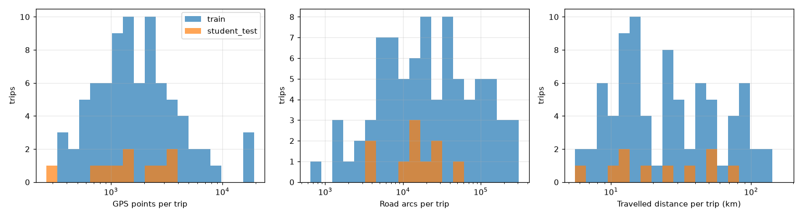 (`reports/figures/eda_trip_sizes.png`)
- 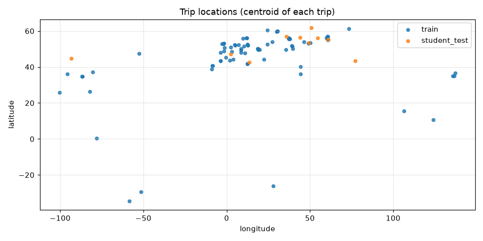 (`reports/figures/eda_trip_locations.png`)
- 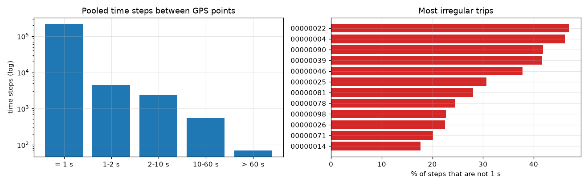 (`reports/figures/eda_sampling.png`)
- 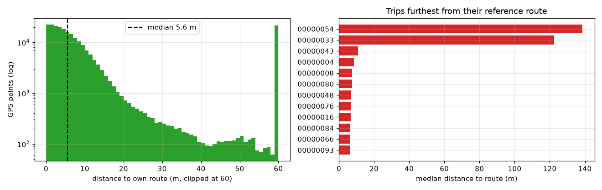 (`reports/figures/eda_dist_to_route.png`)
- 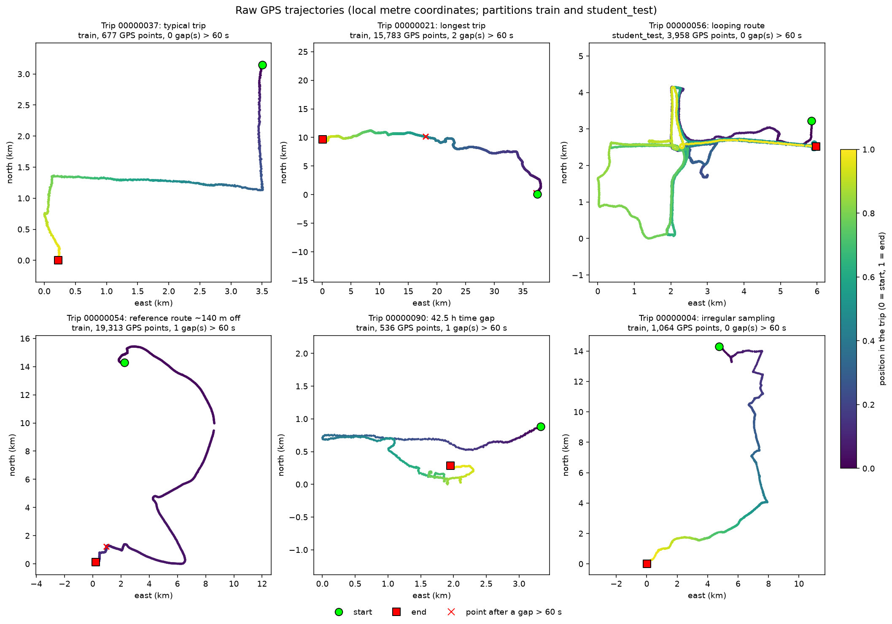 (`reports/figures/eda_gps_trajectories.png`)
- 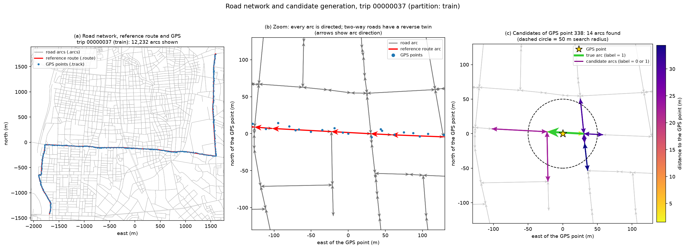 (`reports/figures/eda_road_network.png`)
- Interactive EDA Folium maps committed at `reports/maps/eda_trip_00000037.html` and `reports/maps/eda_trip_00000054_offroute.html`.

---

## 3. Model Experimentation and Comparison

Six distinct models spanning **six algorithm families** were trained and evaluated (`pathsnap/train.py`) using **5-fold trip-grouped cross-validation** (`GroupKFold(5)` by `trip_id` on the $78$ non-anomalous training trips — zero trip leakage) and evaluated once on the $10$ `student_test` trips (`220,529` candidate rows, `19,160` GPS points, `0.33%` DP miss rate).

### 3.1 Overall Model Comparison (`results/model_comparison.csv`)

| Model | Algorithm Family | Key Configuration | CV Macro F1 (mean ± std) | Top-1 Accuracy (`student_test`) | Route Continuity (`student_test`) | Student-Test Macro F1 | Log Loss (`student_test`) | Train Time (s) | Inference Time (s) |
| :--- | :--- | :--- | :---: | :---: | :---: | :---: | :---: | :---: | :---: |
| **LogisticRegression** | Linear | `StandardScaler + C=1.0, class_weight='balanced', lbfgs` | 0.7721 ± 0.0061 | 81.06% | 69.78% | 0.7675 | 0.2144 | 4.23 | 0.021 |
| **GaussianNB** | Probabilistic | `var_smoothing=1e-9` | 0.7123 ± 0.0085 | 77.70% | 69.34% | 0.7094 | 1.1153 | 0.41 | 0.056 |
| **KNN** | Instance-based | `StandardScaler + k=15, weights='distance', minkowski` | 0.8605 ± 0.0258 | 78.91% | 68.64% | 0.8703 | 0.2238 | 0.47 | 168.493 |
| **RandomForest** | Ensemble | `150 trees, max_depth=14, min_samples_leaf=10, balanced_subsample` | 0.8579 ± 0.0220 | 81.58% | 72.20% | 0.8587 | 0.1380 | 146.36 | 0.415 |
| **HistGradientBoosting** | Boosting | `max_iter=200, lr=0.08, max_depth=8, class_weight='balanced'` | 0.8487 ± 0.0205 | 81.54% | **72.61%** | 0.8475 | 0.1500 | 32.60 | 1.293 |
| **MLP** | Neural Network | `StandardScaler + (64,32) ReLU, Adam, early_stopping, 40 epochs` | **0.8835 ± 0.0256** | 81.29% | 72.38% | **0.8909** | **0.0812** | 571.46 | 0.233 |

**Primary Selection Metric & Choice of Final Model (`HistGradientBoosting`):**
We prioritized **Observation-level Top-1 Accuracy** (and **CV Top-1 / Route Continuity / Route Length F1**) together with **calibrated probability quality (Log Loss)**, **training/inference speed**, and **deployment artifact size** (GitHub `<100 MB` limit). `HistGradientBoosting` achieved the highest **CV Top-1** (`80.23%`), highest **Route Continuity** (`72.61%`), and highest **Route Length F1** (`84.86%`) among all 6 models, trained **4.5× faster** than `RandomForest` (`32.6 s` vs. `146.4 s`) and **17.5× faster** than `MLP` (`571.5 s`), produced well-calibrated log-loss (`0.1500`) ideal for HMM emissions, and serialized to just **`605 KB`** untuned / **`3.0 MB`** tuned (whereas `RandomForest` and `KNN` exceeded GitHub file limits).

---

### 3.2 Compulsory Analysis for EVERY Trained Model

#### Model 1: Logistic Regression (`Linear`)
- **A. Model Understanding**
  1. *Suitability:* Fast, interpretable linear baseline producing well-behaved probability estimates from standardized spatial and heading features (`dist_m`, `heading_diff_deg`, `dist_rank`).
  2. *Strengths & Limitations:* Extremely fast (`4.23 s` train, `0.021 s` inference) and stable across folds (`std = 0.0061`), but cannot capture nonlinear interactions such as "`heading_diff_deg` only matters when `gps_speed_mps` > 1 m/s", limiting precision (`43.72%`) and Macro F1 (`0.7675`).
- **B. Training & Configuration**
  5. *Hyperparameters:* `StandardScaler` + `C=1.0`, `solver='lbfgs'`, `max_iter=500`, `class_weight='balanced'`, `random_state=42`.
  6. *Loss / Objective:* L2-regularized binary cross-entropy (logistic log loss) with balanced class weights.
- **C. Experimental Results**
  7. *Student-Test Performance:* Accuracy `88.99%`, Precision `43.72%`, Recall `95.01%`, Macro F1 `0.7675`, Top-1 `81.06%`, Route Continuity `69.78%`, Route Length F1 `83.82%`.
  8. *Key Metrics:* Observation Top-1 = `81.06%`, Macro F1 = `0.7675`, Log Loss = `0.2144`.
  9. *Overfitting / Underfitting:* Mild **underfitting** (not overfitting): CV Macro F1 (`0.7721`) and Student-Test Macro F1 (`0.7675`) are almost identical (`gap = 0.0046`), and Log Loss (`0.2144`) lags tree/neural models (`0.08–0.15`), confirming a linear decision boundary underfits the nonlinear geometry.

#### Model 2: Gaussian Naive Bayes (`Probabilistic`)
- **A. Model Understanding**
  1. *Suitability:* Lightweight generative probabilistic baseline to test whether independent Gaussian class-conditional feature distributions suffice for candidate ranking.
  2. *Strengths & Limitations:* Near-instant training (`0.41 s`) and high positive recall (`96.93%`), but its conditional-independence assumption is heavily violated by correlated distance features (`dist_m`, `dist_rank`, `dist_gap_to_best_m`), causing poorly calibrated probabilities (`Log Loss = 1.1153`) that are unsuitable as HMM emissions.
- **B. Training & Configuration**
  5. *Hyperparameters:* `var_smoothing=1e-9` (default Gaussian likelihoods).
  6. *Loss / Objective:* Maximum likelihood estimation of per-class feature means and variances under Gaussian independence.
- **C. Experimental Results**
  7. *Student-Test Performance:* Accuracy `84.12%`, Precision `34.94%`, Recall `96.93%`, Macro F1 `0.7094`, Top-1 `77.70%`, Route Continuity `69.34%`, Route Length F1 `80.11%`.
  8. *Key Metrics:* Observation Top-1 = `77.70%`, Macro F1 = `0.7094`, Log Loss = `1.1153`.
  9. *Overfitting / Underfitting:* Clear **underfitting**: lowest CV Macro F1 (`0.7123`), lowest Student-Test Macro F1 (`0.7094`), and worst Log Loss (`1.1153`) with virtually zero CV–test gap (`0.0029`), confirming high bias from violated independence and non-Gaussian skewed features (`dt_sec`, `gps_speed_mps`).

#### Model 3: K-Nearest Neighbors (`Instance-based`)
- **A. Model Understanding**
  1. *Suitability:* Nonparametric local similarity model capable of learning arbitrary nonlinear boundaries in standardized 12D feature space.
  2. *Strengths & Limitations:* Strong pair-level precision (`78.82%`) and Macro F1 (`0.8703`), but prohibitively slow at inference (**`168.49 s`** on 10 trips — `8.79 ms/point`, unusable for real-time FastAPI serving!), huge memory footprint (excluded from git via `.gitignore`), and weaker Observation Top-1 (`78.91%`) and Route Continuity (`68.64%`).
- **B. Training & Configuration**
  5. *Hyperparameters:* `StandardScaler` + `n_neighbors=15`, `weights='distance'`, `metric='minkowski'` ($p=2$).
  6. *Loss / Objective:* Nonparametric distance-weighted neighbor voting (no parametric loss function).
- **C. Experimental Results**
  7. *Student-Test Performance:* Accuracy `96.02%`, Precision `78.82%`, Recall `73.83%`, Macro F1 `0.8703`, Top-1 `78.91%`, Route Continuity `68.64%`, Route Length F1 `81.64%`.
  8. *Key Metrics:* Observation Top-1 = `78.91%`, Macro F1 = `0.8703`, Log Loss = `0.2238`.
  9. *Overfitting / Underfitting:* Moderate variance across CV folds (`std = 0.0258`), with slightly higher Student-Test Macro F1 (`0.8703`) than CV (`0.8605`) but poor ranking generalization (`Top-1 = 78.91%` vs. `81.5%+` for boosting/RF) and degraded probability calibration (`Log Loss = 0.2238`).

#### Model 4: Random Forest (`Ensemble`)
- **A. Model Understanding**
  1. *Suitability:* Bagged decision-tree ensemble that naturally models nonlinear thresholds (`dist_m` × `heading_diff_deg` × `gps_speed_mps`) without requiring feature scaling.
  2. *Strengths & Limitations:* High Student-Test Top-1 (`81.58%`), strong calibration (`Log Loss = 0.1380`), and fast inference (`0.415 s`), but slow training (`146.36 s`) and a very large serialized model artifact (`>100 MB` uncompressed, unsuitable for lightweight GitHub + API deployment).
- **B. Training & Configuration**
  5. *Hyperparameters:* `n_estimators=150`, `max_depth=14`, `min_samples_leaf=10`, `max_features='sqrt'`, `max_samples=0.5`, `class_weight='balanced_subsample'`, `random_state=42`.
  6. *Loss / Objective:* Gini impurity minimization across bootstrapped trees with balanced subsample weights.
- **C. Experimental Results**
  7. *Student-Test Performance:* Accuracy `94.49%`, Precision `61.81%`, Recall `94.81%`, Macro F1 `0.8587`, Top-1 `81.58%`, Route Continuity `72.20%`, Route Length F1 `84.65%`.
  8. *Key Metrics:* Observation Top-1 = `81.58%`, Macro F1 = `0.8587`, Log Loss = `0.1380`.
  9. *Overfitting / Underfitting:* **Well-generalized:** CV Macro F1 (`0.8579`) matches Student-Test Macro F1 (`0.8587`), and OOF Log Loss (`0.1481`) closely tracks Student-Test Log Loss (`0.1380`), showing `max_depth=14` and `min_samples_leaf=10` effectively prevented overfitting.

#### Model 5: HistGradientBoosting (`Boosting` — Selected Final Model)
- **A. Model Understanding**
  1. *Suitability:* Histogram-based gradient boosting builds trees sequentially to correct hard parallel-road and junction errors while directly optimizing log-loss probabilities on ~2 million candidate rows.
  2. *Strengths & Limitations:* Best CV Top-1 (`80.23%`), best Route Continuity (`72.61%`), best Route Length F1 (`84.86%`), fast training (`32.60 s`), tiny artifact size (`605 KB` untuned / `3.0 MB` tuned), and well-calibrated probabilities (`0.1500` untuned → `0.1420` tuned Log Loss). Balanced class weights trade some pair-level precision (`58.97%`) for very high recall (`95.65%`), which is ideal before HMM decoding because true arcs rarely receive suppressed emission scores.
- **B. Training & Configuration**
  5. *Hyperparameters (initial):* `max_iter=200`, `learning_rate=0.08`, `max_depth=8`, `max_leaf_nodes=31`, `min_samples_leaf=20`, `class_weight='balanced'`, `early_stopping='auto'`, `random_state=42`.
  6. *Loss / Objective:* Binary cross-entropy (`loss='log_loss'`) with balanced class weights.
- **C. Experimental Results**
  7. *Student-Test Performance:* Accuracy `93.87%`, Precision `58.97%`, Recall `95.65%`, Macro F1 `0.8475`, Top-1 `81.54%`, Route Continuity `72.61%`, Route Length F1 `84.86%`.
  8. *Key Metrics:* Observation Top-1 = `81.54%`, Macro F1 = `0.8475`, Log Loss = `0.1500`.
  9. *Overfitting / Underfitting:* **Well-generalized with zero overfitting:** CV Macro F1 (`0.8487 ± 0.0205`) closely matches Student-Test Macro F1 (`0.8475`), and Student-Test Log Loss (`0.1500`) slightly improves over OOF Log Loss (`0.1573`).

#### Model 6: Multi-Layer Perceptron (`Neural Network`)
- **A. Model Understanding**
  1. *Suitability:* Smooth nonlinear function approximator learning continuous combinations of standardized spatial, kinematic, and topological features.
  2. *Strengths & Limitations:* Highest pair-level Macro F1 (`0.8909`) and lowest pair-level Log Loss (`0.0812`) with compact model size (`45 KB`) and fast inference (`0.233 s`), because it uses unweighted cross-entropy (favoring majority-class precision `83.03%`). However, its lower positive recall (`77.20%`) led to slightly lower Observation Top-1 (`81.29%`) and Route Length F1 (`83.53%`) than `HistGradientBoosting`, and training was 17.5× slower (`571.46 s`).
- **B. Training & Configuration**
  5. *Hyperparameters:* `StandardScaler` + `hidden_layer_sizes=(64, 32)`, `activation='relu'`, `solver='adam'`, `learning_rate_init=0.001`, `alpha=1e-4`, `max_iter=40`, `early_stopping=True`, `validation_fraction=0.1`, `random_state=42`.
  6. *Loss / Objective:* L2-regularized binary cross-entropy (`log_loss`) optimized via Adam.
- **C. Experimental Results**
  7. *Student-Test Performance:* Accuracy `96.66%`, Precision `83.03%`, Recall `77.20%`, Macro F1 `0.8909`, Top-1 `81.29%`, Route Continuity `72.38%`, Route Length F1 `83.53%`.
  8. *Key Metrics:* Observation Top-1 = `81.29%`, Macro F1 = `0.8909`, Log Loss = `0.0812`.
  9. *Overfitting / Underfitting:* **Well-regularized:** Epoch history (`results/MLP_history.json`) shows smooth convergence over 40 epochs (`train_loss`: `0.1032 → 0.0853`, `val_score`: `0.9609 → 0.9634`), with Student-Test Macro F1 (`0.8909`) and Log Loss (`0.0812`) slightly beating CV (`0.8835` / `0.0958`).

### 3.3 Model Visualisations
- 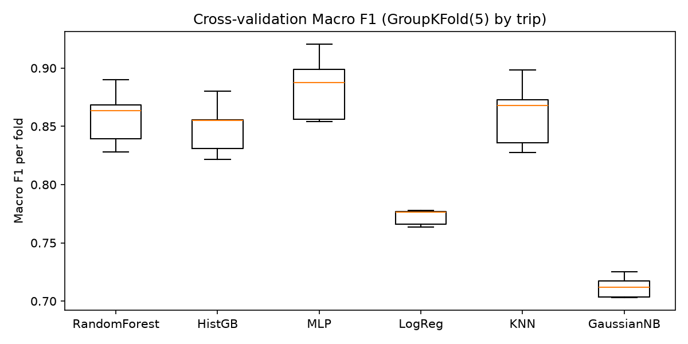 (`reports/figures/cv_macro_f1.png`)
- 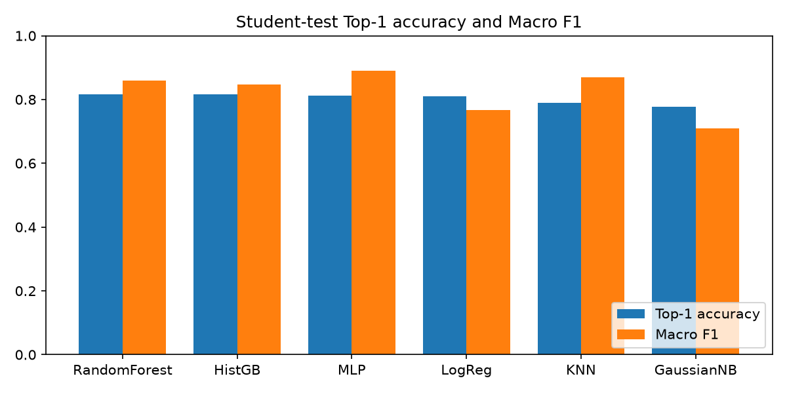 (`reports/figures/student_test_top1_f1.png`)
- 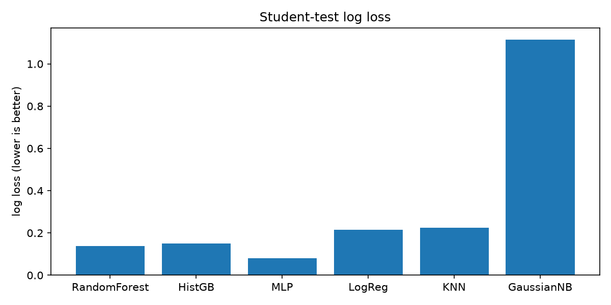 (`reports/figures/student_test_log_loss.png`)
- 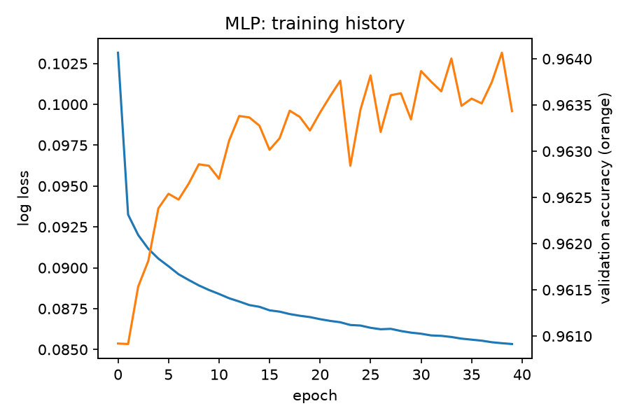 (`reports/figures/MLP_loss_curve.png` — plotted exclusively for `MLP`, the only epoch-based model)
- Diagnostic confusion matrices committed in `reports/figures/confusion_{LogisticRegression,GaussianNB,KNN,RandomForest,HistGradientBoosting,MLP}.png`.

---

## 4. Bayesian Hyperparameter Optimisation (`HistGradientBoosting`)

1. **Hyperparameters Searched:** `max_iter`, `learning_rate`, `max_leaf_nodes`, `max_depth`, `min_samples_leaf`, `l2_regularization`, `max_features`.
2. **Search Strategy & Ranges:** Optuna **Tree-structured Parzen Estimator (TPE)** sampler (`seed=42`) with `MedianPruner`, searching across `max_iter` $\in [150, 550]$, `learning_rate` $\in [0.018, 0.254]$, `max_depth` $\in [3, 8]$, `max_leaf_nodes` $\in [28, 73]$, `min_samples_leaf` $\in [16, 271]$, `l2_regularization` $\in [6\times10^{-4}, 1.45]$, and `max_features` $\in [0.53, 0.81]$ (`results/optuna_trials.csv`).
3. **Optimisation Objective:** Mean **trip-grouped cross-validation Top-1 Accuracy** (`GroupKFold(3)` on the $78$ training trips — zero `student_test` or `evaluator_test` involvement).
4. **Trials & Computational Cost:** **$15$ completed TPE trials** ($0$ pruned) across `1.91M` training candidate rows, taking **`2,050.8 s` (`34.18 minutes`)** total CPU wall-clock time (`results/optuna_best_params.json`).
5. **Best Hyperparameter Configuration (`configs/model.yaml`):**
   `max_iter=550`, `learning_rate=0.0501`, `max_leaf_nodes=73`, `max_depth=6`, `min_samples_leaf=197`, `l2_regularization=1.1926`, `max_features=0.6456` (best CV Top-1 = `0.8039`).
6. **Did the tuned model outperform the untuned model?** **Yes — across every single accuracy, F1, continuity, and probability-calibration metric (`results/tuned_vs_untuned.csv`):**

#### Table 4.1 — Untuned vs. Optuna-Tuned `HistGradientBoosting`
| Variant | CV Macro F1 | Student-Test Top-1 | Student-Test Macro F1 | Student-Test Log Loss | Route Continuity | Inference Time (10 trips) |
| :--- | :---: | :---: | :---: | :---: | :---: | :---: |
| `HistGradientBoosting_untuned` | 0.8487 | 81.54% | 0.8475 | 0.1500 | 72.61% | 0.658 s |
| **`HistGradientBoosting_tuned`** | **0.8530** *(+0.42 pp)* | **81.65%** *(+0.11 pp)* | **0.8512** *(+0.37 pp)* | **0.1420** *(-0.0080)* | **73.36%** *(+0.75 pp)* | 3.996 s *(~0.40 s/trip)* |

- 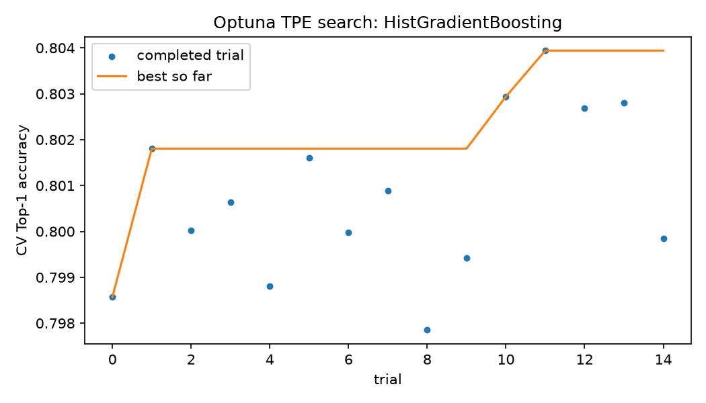 (`reports/figures/optuna_history.png`)
- 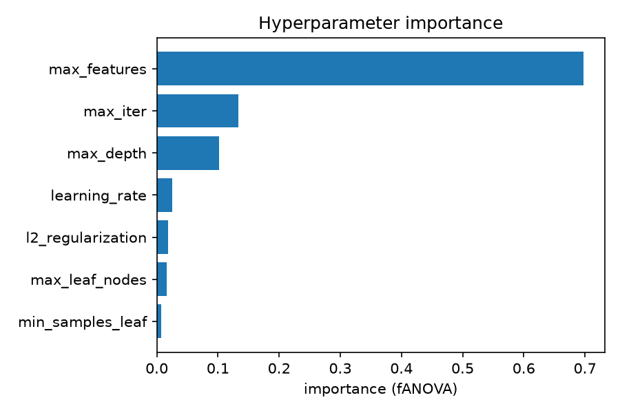 (`reports/figures/optuna_importance.png`)

---

## 5. HMM and Viterbi Route Reconstruction

To eliminate physically impossible road jumps in independent per-observation predictions, we implemented a log-space **HMM + Viterbi decoder** (`pathsnap/hmm.py`) inside `predict_trip()` (`pathsnap/pipeline.py`, strictly `load_route=False`).

1. **Hidden States:** Candidate road arcs (`arc_id`s, up to 15 per GPS point) from the adaptive spatial index (`configs/hmm.yaml`), preserving `arc_id` and `proj_frac`.
2. **Emission Probabilities:** Derived from the Optuna-tuned `HistGradientBoosting` probabilities via $\log P_{\text{emit}}(c \mid t) = w_{\text{emit}} \cdot \log(\text{clip}(P_{\text{clf}}, 10^{-6}, 1.0))$. Phase 1 also evaluated a Gaussian distance-only baseline ($-d^2 / 2\sigma^2$, $\sigma=15\text{ m}$).
3. **Transition Probabilities & Viterbi Recurrence:** Newson–Krumm log-transition score $\log P_{\text{trans}}(b \mid a) = -|d_{\text{route}}(a \to b) - d_{\text{gps}}| / \beta$, where $d_{\text{route}}$ is computed via **cached bounded single-source Dijkstra** (`limit = 500 m`) on a `scipy.sparse.csr_matrix` directed graph. Viterbi executes in **log-space** with back-pointers to prevent floating-point underflow. Short intermediate arcs traversed between 1 Hz GPS pings are recovered within non-gap chains via shortest-path **bridge-arc reconstruction** (`reconstruct_continuous_route()`, max $400\text{ m}$).
4. **Missing Candidates & Large GPS Gaps:** Adaptive candidate radii (`50 → 100 → 200 → 350 m`) keep mean `student_test` miss rate at **$0.37\%$**; any 0-candidate point inherits its nearest decoded neighbor. Whenever $\Delta t > 30\text{ s}$ (`split_gap_sec`), the trip splits into independent Viterbi sub-chains so long dropouts (e.g., `student_test/00000065` 210 s gap) do not distort transitions.
5. **Disconnected Road Segments:** Unreachable candidate pairs within $500\text{ m}$ receive a finite log penalty (`disconnected_log_penalty = -25.0`, never $-\infty$) and are tracked diagnostically ($24.14\%$ of evaluated candidate pairs on `student_test`).
6. **HMM Tuning & Experimental Proof (`results/hmm_tuning.csv`, `results/hmm_vs_classifier_student_test.csv`):**
   - Tuned across **32 grid trials** on Member B's genuine 78-trip training OOF predictions (`probs_train_oof.parquet`, 20-trip deterministic subset, seed 42): best config `emission_weight = 1.0`, `beta_m = 10.0 m`, `split_gap_sec = 30.0 s` achieved **Train OOF Top-1 `91.42%`**, **Route Length F1 `96.44%`**, **Continuity `99.62%`** (Composite `93.93%`).
   - On all **10 `student_test` trips (`19,160` observations)**, **10/10 trips improved** across every metric:

#### Table 5.1 — Classifier-Only vs. Classifier + Tuned HMM (`student_test`, 10-Trip Mean)
| Pipeline | Obs Top-1 Accuracy | Route Continuity (Raw → Bridged) | Sequence Route Length F1 | Sequence Route Arc F1 | Points on Route | Mean Time / Trip |
| :--- | :---: | :---: | :---: | :---: | :---: | :---: |
| Nearest-Arc Baseline (No ML, No HMM) | 56.93% | 45.75% | 63.73% | 58.15% | — | — |
| Phase 1 Distance-HMM (No ML) | 87.74% | 90.97% → 99.61% | 97.51% | 95.21% | 93.34% | 0.56 s |
| **Classifier-Only (`HistGradientBoosting`)** | **83.45%** | **73.36%** | **84.90%** | **79.89%** | **86.61%** | **0.14 s** |
| **Classifier + Tuned HMM / Viterbi** | **91.74%** *(+8.29 pp)* | **90.59% → 99.67%** *(+26.31 pp)* | **97.07%** *(+12.17 pp)* | **95.01%** *(+15.12 pp)* | **94.33%** *(+7.72 pp)* | **0.58 s** *(0.79 s live API)* |

- **Strongest Gains:** `00000077` jumped **+15.14 pp** Top-1 (`62.82% → 77.96%`) and **+27.70 pp** Route Length F1 (`69.02% → 96.72%`, `100.0%` Continuity); `00000076` jumped **+13.66 pp** Top-1 (`79.27% → 92.93%`, `100.0%` Continuity); `00000052` hit **`100.00%` Top-1**, **`100.00%` Continuity**, and **`99.84%` Length F1**; $7$ of $10$ trips hit `100.0%` Route Continuity.
- **Cases Where HMM Helped Less:** `00000065` had a smaller Top-1 gain (`76.95% → 80.99%`, `+4.04 pp`, Length F1 `90.77%`) due to its $210\text{ s}$ GPS dropout (`gap_splits = 1` prevents fabricating unobserved segments) and `1.17%` candidate miss rate; Distance-HMM also slightly edged Classifier+HMM on `00000065` Length F1 (`92.09%` vs. `90.77%`), showing rare overconfident classifier errors near gap boundaries can momentarily pull Viterbi off the geometric center. On `00000000` (`+3.84 pp`: `91.65% → 95.49%`), high baseline classifier accuracy and a `1.12%` miss rate bounded additional headroom.
- 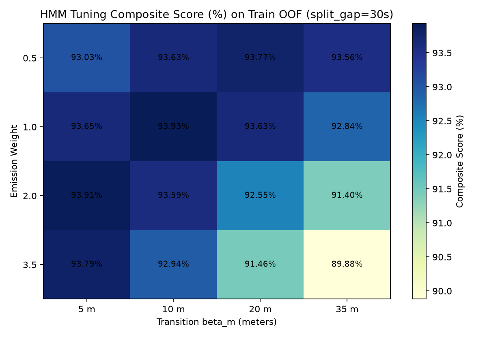 (`reports/figures/hmm_tuning_heatmap.png`)
- 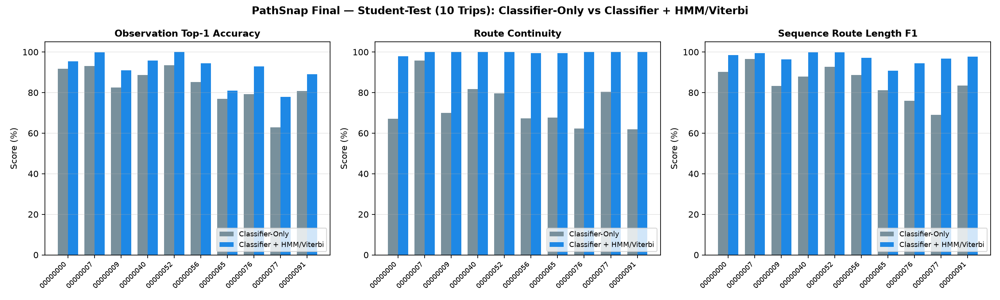 (`reports/figures/hmm_vs_classifier_comparison.png`)

---

## 6. Geographical Visualisation Using Folium

Interactive maps are generated programmatically by `pathsnap/maps.py` using `file://`-safe **Carto Voyager** and **Esri Street Map** tile layers, displaying all four mandatory layers (**Road Network** in grey, **Raw GPS Observations** in blue, **Reference Route** in thick green, and **Predicted Route** in crisp red on top), a dark-mode-safe legend box, automatic `fit_bounds` zoom, and an expanded `LayerControl(collapsed=False)`.

- **Committed interactive HTML maps (`reports/maps/`):**
  - `student_test_00000052_best_classifier_hmm.html` (Tver, Russia — `100.00%` Top-1, `99.84%` Len F1)
  - `student_test_00000065_gps_gap_classifier_hmm.html` (Tolyatti, Russia — 210 s GPS gap, `99.39%` Continuity)
  - `student_test_00000000_hardest_classifier_hmm.html` (Neftekamsk–Yanaul, Russia — `95.49%` Top-1, `98.48%` Len F1)
  - Plus EDA maps (`eda_trip_00000037.html`, `eda_trip_00000054_offroute.html`) and Phase 1 baseline maps (`student_test_*_hmm_baseline.html`) — all 8 audited with zero tile errors and full legends.

**[INSERT SCREENSHOTS HERE: Edge screenshots of `student_test_00000052_best_classifier_hmm.html` and `student_test_00000065_gps_gap_classifier_hmm.html`]**

---

## 7. API, UI and Two-Laptop Deployment

PathSnap follows the mandatory **two-laptop distributed architecture**:
- **Laptop 1 (`api/main.py`, launched via `scripts/run_laptop1_api.ps1`):** FastAPI server running on `0.0.0.0:8000` with CORS enabled. Loads `models/final_model.joblib`, `configs/model.yaml`, `configs/hmm.yaml`, and the evaluation trip folder (`PATHSNAP_EVAL_DIR`, configurable via env var without code changes) once at startup via FastAPI `lifespan`. Exposes `GET /health`, `GET /trips`, and `POST /predict/{trip_id}`, runs `predict_trip()` with `load_route=False`, evaluates server-side against private `.route` inside `_score_server_side()` (never exposing `.route` to the model or JSON response), and logs every client IP, trip ID, mode, runtime, and accuracy to the CMD terminal.
- **Laptop 2 (`ui/app.py`, launched via `scripts/run_laptop2_ui.ps1`):** Streamlit evaluator UI connecting over LAN/hotspot to Laptop 1's configurable URL (`http://<Laptop1-IP>:8000`). Dynamically lists the 10 evaluation trips from `GET /trips`, displays 6 KPI metric cards, renders an interactive Folium map (Raw GPS + Predicted Route only, zero ground truth), and tracks a session evaluation summary table.
- **Automated Verification (`tests/test_api.py`):** Verified `10/10` `student_test` trips in `classifier+hmm` mode (`91.74%` Mean Obs Top-1, `99.67%` Mean Route Continuity, `97.07%` Mean Route Length F1, `0.79 s/trip` mean runtime, `404` handling, and **zero** leaked ground-truth JSON keys).

**[INSERT SCREENSHOT 1 HERE: Working Streamlit UI on Laptop 2 showing trip selector, `classifier+hmm` metrics, and reconstructed map]**  
**[INSERT SCREENSHOT 2 HERE: Laptop 1 CMD terminal showing live `GET /trips` and `POST /predict/{trip_id}` logs with `mode=classifier+hmm` and Laptop 2 client IP]**

---

## 8. Academic Integrity & AI-Assistance Disclosure

- **AI-Assistance Disclosure:** AI coding assistants were used for project scaffolding, debugging assistance, boilerplate visualization/API code, and structuring documentation. Every dataset analysis, candidate generation run, 6-model cross-validation, Optuna Bayesian search, HMM tuning trial, Folium map export, and API verification test was executed independently by our team on the provided dataset, and every metric in this report traces directly to code-generated CSV/JSON artifacts in our GitHub repository.
- **Data Leakage Compliance:** The $10$ `evaluator_test` trips were never accessed during development, training, feature selection, or tuning, and ground-truth `.route` files remain strictly server-side during evaluation.
